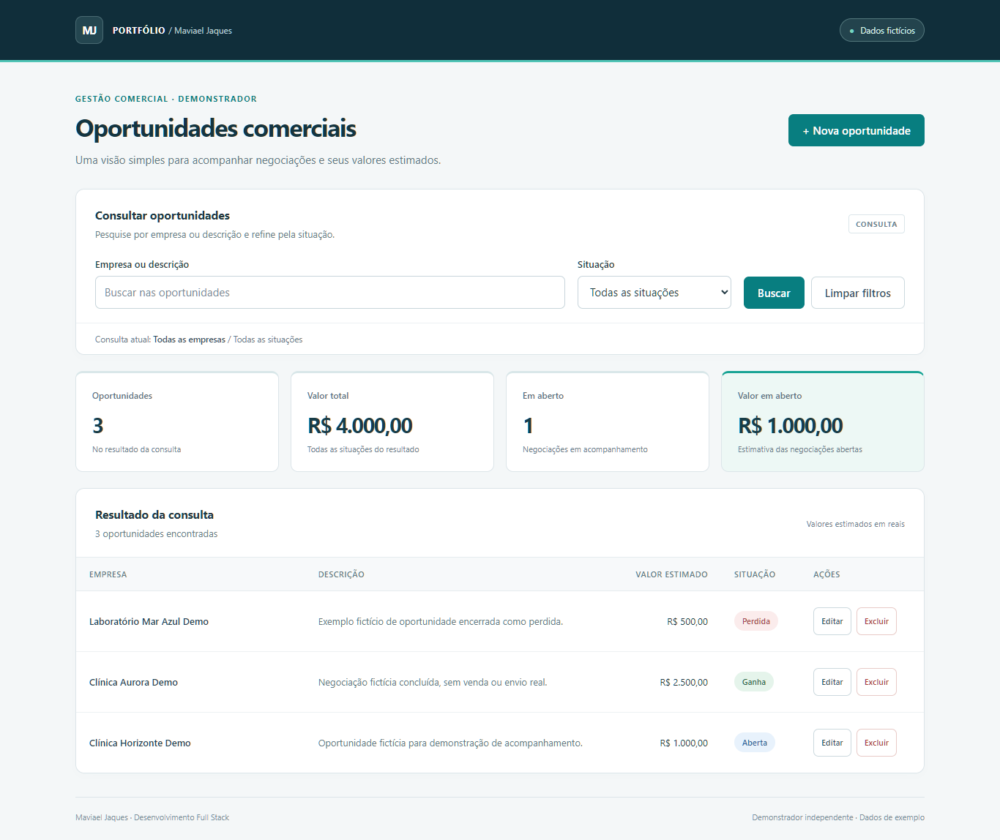

# Portfólio de oportunidades comerciais

Demonstrador full stack desenvolvido por **Maviael Jaques**, com apoio de IA e verificação do código.
Apresenta um fluxo de gestão de oportunidades: cadastro, consulta, edição, exclusão confirmada,
pesquisa, filtros e totais. Usa apenas empresas e valores fictícios.

Este projeto é independente do Sistema Águia e do Bureau. Não contém seus bancos ou código privado.

## Tecnologias e decisões

- React e TypeScript na interface; Vite no desenvolvimento e build.
- Node.js **24.x** e Express na API.
- SQLite pelo módulo nativo node:sqlite; sem servidor de banco separado.
- Vitest/Supertest para banco e API; Playwright para o fluxo no navegador.
- Valores monetários guardados em centavos; buscas literais e SQL parametrizado.
- Versões exatas das dependências nos package-lock.json de server e web.

## Instalação no Windows

1. Instale Node.js 24.x atualizado e Git.
2. Clone este repositório usando o endereço fornecido pelo GitHub e abra sua pasta.
3. Execute na raiz, uma linha por vez:

~~~powershell
node --version
npm.cmd ci --prefix server
npm.cmd ci --prefix web
npm.cmd --prefix server run seed
~~~

O seed cria três oportunidades somente se o banco estiver vazio.
Repetir não apaga, altera ou duplica registros. O banco fica em server/data/portfolio.db,
independente da pasta em que o comando foi iniciado; esse arquivo não é versionado.

### Node portátil usado pelo autor

Na máquina do autor, o runtime fica em .tools e é ignorado pelo Git. Ele não acompanha o clone.
Use seu Node 24 instalado. Não é necessário alterar o Node global para quem já utiliza um
gerenciador de versões. Confira node --version em cada terminal.

## Executar localmente

Abra dois terminais na raiz do projeto.

**Terminal 1 — API**

~~~powershell
npm.cmd --prefix server run dev
~~~

Saúde: http://127.0.0.1:3001/api/health — resposta esperada: {"ok":true}.

**Terminal 2 — interface**

~~~powershell
npm.cmd --prefix web run dev
~~~

Abra http://localhost:5173. Mantenha ambos os terminais abertos; Ctrl+C encerra cada serviço.
O frontend chama /api pelo proxy do Vite; não precisa liberar CORS.

### Configuração opcional por ambiente

Padrões: API em 127.0.0.1:3001 e interface localhost:5173.
PORT altera a porta da API; PORTFOLIO_API_URL altera o destino do proxy Vite.
Não há leitura automática de .env; defina as variáveis no terminal antes de iniciar o serviço.
Nenhuma chave externa é necessária. A mudança de porta da interface pode usar -- --port 5174.

## Experimentar

A carga inicial mostra 3 oportunidades, R$ 4.000,00 no total e uma aberta de R$ 1.000,00.
Filtre por Aberta para ver Clínica Horizonte Demo. Pesquise algo inexistente para conferir o vazio.
Crie um registro fictício de R$ 1.234,50, edite para R$ 1.500,00, cancele uma exclusão e depois
exclua apenas seu registro. Os filtros são mantidos ao salvar.

## Verificações

Na raiz:

~~~powershell
npm.cmd --prefix server run typecheck
npm.cmd --prefix server test
npm.cmd --prefix web run lint
npm.cmd --prefix web run build
~~~

Os 43 testes atuais de banco/API usam bases isoladas, inclusive arquivo temporário para
conferir persistência ao fechar e reabrir. Eles não alteram sua base de demonstração.

### Testes de navegador

Com API e frontend ligados, em Windows com Microsoft Edge:

~~~powershell
npm.cmd --prefix web run test:e2e
~~~

Os seis testes de navegador esperam os três registros fictícios iniciais.
O teste de CRUD cria e remove somente seu registro temporário; não apaga os exemplos.
Se você alterou a base manualmente, use uma cópia limpa para essa verificação.
As capturas geradas em docs/images contêm apenas dados fictícios; revise-as antes de publicar.

Em outro sistema operacional, instale Chromium pelo Playwright e defina PLAYWRIGHT_CHANNEL=chromium.
Na CI, o navegador é instalado e os serviços são iniciados automaticamente em uma cópia limpa.

## Estrutura

- server/src/app.ts: aplicação Express, injetada com uma conexão de banco.
- server/src/index.ts: inicialização e encerramento do servidor.
- server/src/db.ts e seed*: schema e carga fictícia.
- server/src/validation.ts, repository.ts, routes.ts: validação, SQL e HTTP.
- server/tests: testes da API e da persistência.
- web/src/components: filtros, resumo, lista e formulário.
- web/src/api.ts: cliente HTTP e mensagens de erro.
- web/e2e: fluxo completo de consulta e CRUD no navegador.
- .github/workflows/ci.yml: verificações preparadas para push e pull request.
- docs/api.md, decisoes.md, verificacao.md e diario.md: contrato e evidências.

## Autoria e uso de IA

As decisões e a construção são acompanhadas pelo autor em etapas, com assistência de IA na
implementação e nos testes. O histórico e o diário registram a evolução real do demonstrador.
A verificação inclui tipos, análise estática, API e navegação; não significa ausência de todo defeito.

## Limites e estado da entrega

- Sem autenticação: API destinada ao uso local, não preparada para exposição pública.
- Sem integração com sistemas comerciais, envio de mensagens ou dados reais.
- Sem paginação: adequado apenas a um conjunto pequeno de demonstração.
- Totais são estimativas das oportunidades filtradas, não faturamento ou vendas reconhecidas.
- Persistência síncrona SQLite escolhida pela simplicidade da amostra.
- CI aprovada em Linux/Chromium: [execução verificada](https://github.com/jaques98/portfolio-oportunidades/actions/runs/45190192822).
- Repositório público: https://github.com/jaques98/portfolio-oportunidades .
- Licença pública ainda será definida antes da divulgação. Não inferir licença do template.

## Próximos passos

Definir a licença pública e desenvolver as demonstrações em vídeo dos produtos.
As demonstrações em vídeo do Águia e BuscaDOU são uma entrega separada.
